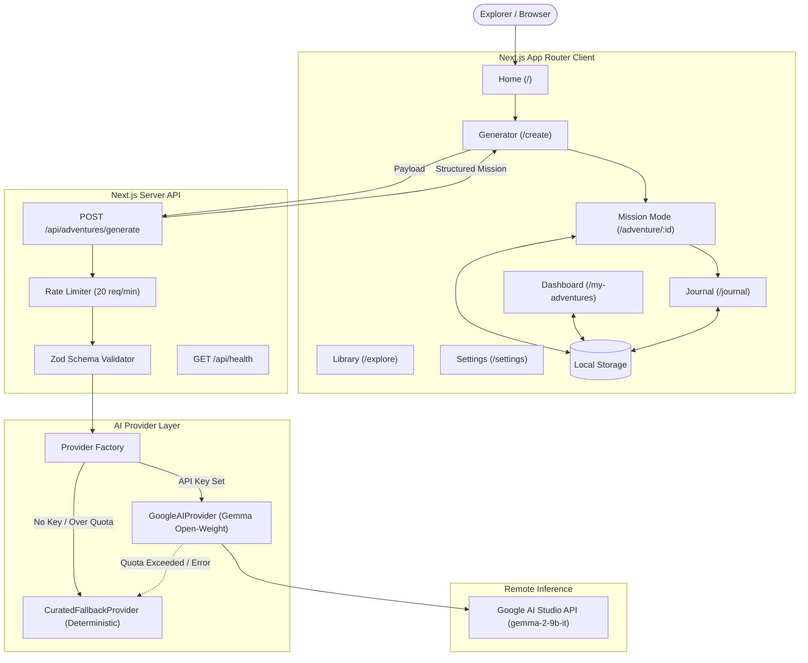

# 🌲 TerraQuest AI

<p align="center">
  <strong>"Less scrolling. More exploring."</strong><br>
  <em>An open-weight AI outdoor adventure companion built for Hacktoberfest 2026 Week 1: Touch Grass.</em>
</p>

<p align="center">
  <a href="#-quick-start">Quick Start</a> &bull;
  <a href="#-core-concept">Core Concept</a> &bull;
  <a href="#-features">Features</a> &bull;
  <a href="#-system-architecture">Architecture</a> &bull;
  <a href="#-open-weight-ai-model">Open-Weight AI</a> &bull;
  <a href="#-documentation">Docs</a> &bull;
  <a href="#-license">License</a>
</p>

---

## 📖 The Problem & Vision

Modern humans spend over 7 hours a day staring into backlit displays. This chronic screen exposure fuels digital fatigue, shortened attention spans, and sensory deprivation. While many intend to spend more time outdoors, turning that intention into reality is blocked by friction: *Where do I go? What should I do? I only have 15 minutes.*

Most AI tools worsen this issue: they are conversational chatbots designed to maximize on-screen session duration.

**TerraQuest AI inverts this paradigm.**

> **Core Product Principle:**  
> *"AI creates the plan. The user experiences the world."*

TerraQuest AI takes your available time (10 to 120 minutes), energy level, environmental setting, group dynamic, and accessibility preferences, and immediately synthesizes an actionable **Outdoor Mission Card**. You review your checklist, enter **Screen-Free Mode**, pocket your device, and engage your senses with the physical earth.

---

## ✨ Features

- ⚡ **Personalized Adventure Generator (`/create`):** Dynamically structures real-world outdoor missions matching your schedule and mobility constraints.
- 📴 **Distraction-Free Mission Mode (`/adventure/[id]`):** An unhurried step player with an activity timer, step progression, and an ultra-minimal, high-contrast **Screen-Free Focus Mode** engineered for bright outdoor sunlight.
- 📚 **Curated Nature Mission Library (`/explore`):** A collection of verified, ready-to-use outdoor activities accessible with zero latency and zero API calls.
- 📊 **Local-First Adventures Dashboard (`/my-adventures`):** Tracks authentic verified outdoor minutes and completed activities with zero remote tracking.
- 📓 **Private Nature Reflection Journal (`/journal`):** Capture sensory observations (touch, sound, sight) and state shifts (before vs. after), with one-click **CSV** and **JSON** export.
- 🛡️ **Diagnostics & Privacy Center (`/settings`):** Live telemetry querying `/api/health`, transparent disclosures, and a double-confirmed local data wipe action.
- 🌓 **Forest-Inspired Design System:** Tailored nature palette (`#173D2B`, `#7BAE70`, `#F8F7F0`, `#E8BE71`), fluid typography, and persistent dark/light theme switch.

---

## 🏗️ System Architecture



---

## 🤖 Open-Weight AI Model

TerraQuest AI is architected around Google's **Gemma open-weight instruction models** (`gemma-2-9b-it`), accessed via the official `@google/genai` SDK:

- **Open-Weight License:** Governed by the [Gemma Terms of Use](https://ai.google.dev/gemma/terms), enabling inspection, customization, and fine-tuning.
- **Why Open-Weight Matters:** By implementing an adapter pattern (`AIProvider`), TerraQuest AI is never locked into a single proprietary cloud API. The model layer can be swapped to local Ollama, vLLM, or self-hosted GPU infrastructure without code changes.
- **Strict Schema Enforcement:** Output is strictly validated with **Zod** against `AdventureMissionSchema`, ensuring step durations sum accurately to requested minutes.
- **Deterministic Curated Fallback:** If the remote API reaches rate limits, quota exhaustion, or goes offline, TerraQuest transparently routes through the deterministic curated engine. Every response carries a clear source disclosure badge.

---

## 💻 Tech Stack

- **Frontend:** Next.js 16 (App Router), React 19, TypeScript (strict mode), Tailwind CSS, Lucide Icons, Canvas Confetti.
- **Backend:** Next.js Route Handlers, Zod, Server-Only Environment Variable Resolution.
- **AI Integration:** `@google/genai` (v2.28.0) querying `gemma-2-9b-it`.
- **Testing:** Vitest v4.1 (13 tests, 100% pass rate).
- **Persistence:** In-browser `localStorage` with safe SSR hydration checks.

---

## 🚀 Quick Start

### 1. Clone & Install
```bash
git clone https://github.com/Jagannath357/Hacktoberfest-week1.git
cd Hacktoberfest-week1
npm install
```

### 2. Configure Environment Variables (Optional)
```bash
cp .env.example .env.local
```
Edit `.env.local`:
```bash
GOOGLE_AI_API_KEY=your_google_ai_studio_api_key_here
AI_MODEL=gemma-2-9b-it
AI_PROVIDER=google
```
*(Note: If `GOOGLE_AI_API_KEY` is omitted, the application runs seamlessly using the deterministic curated engine!)*

### 3. Run Tests
```bash
npm test
```

### 4. Start Development Server
```bash
npm run dev
```
Open [http://localhost:3000](http://localhost:3000) in your browser.

### 5. Build for Production
```bash
npm run build
npm run start
```

---

## 📚 Documentation Suite

Comprehensive project documentation is maintained in the [`docs/`](./docs) directory:

- [**PROJECT_OVERVIEW.md**](./docs/PROJECT_OVERVIEW.md) — Problem statement, target personas, and challenge alignment.
- [**ARCHITECTURE.md**](./docs/ARCHITECTURE.md) — Technical architecture, sequence diagrams, and resilience patterns.
- [**FEATURES.md**](./docs/FEATURES.md) — Detailed feature breakdown and UI specifications.
- [**AI_MODEL_AND_API.md**](./docs/AI_MODEL_AND_API.md) — Gemma open-weight details, licensing, and token constraints.
- [**API_DOCUMENTATION.md**](./docs/API_DOCUMENTATION.md) — Endpoint contracts, schemas, and response codes.
- [**SECURITY_AND_PRIVACY.md**](./docs/SECURITY_AND_PRIVACY.md) — Credential safety, rate limiting, and local data ownership.
- [**TESTING.md**](./docs/TESTING.md) — Unit test results, build logs, and defects resolved.
- [**DEPLOYMENT.md**](./docs/DEPLOYMENT.md) — Step-by-step local and Vercel hosting instructions.
- [**DEMO_SCRIPT.md**](./docs/DEMO_SCRIPT.md) — 75-second video walkthrough script.
- [**HACKTOBERFEST_SUBMISSION.md**](./docs/HACKTOBERFEST_SUBMISSION.md) — DEV Community article draft and tags.
- [**CHANGELOG.md**](./docs/CHANGELOG.md) — Release notes and implementation milestones.
- [**CURRENT_STATUS.md**](./docs/CURRENT_STATUS.md) — Production readiness report and operational status.
- [**TODO.md**](./docs/TODO.md) — Roadmap and P2 future enhancements.

---

## 🔒 Security & Privacy

- **Server-Side Key Isolation:** API credentials reside strictly in server environment variables and are never bundled into client scripts.
- **Zero Third-Party Trackers:** No analytics or fingerprinting scripts.
- **Private Data Residency:** Adventures and reflections are stored exclusively in your browser's `localStorage` and can be wiped with one click.
- **Outdoor Safety First:** Prompts enforce Leave No Trace ethics, pedestrian trail safety, and respect for wild ecosystems.

---

## 📄 License

This project is licensed under the [MIT License](./LICENSE).  
Gemma model weights and architecture are subject to the [Gemma Terms of Use](https://ai.google.dev/gemma/terms).

---

<p align="center">
  Built with care for <strong>Hacktoberfest 2026 Week 1: Touch Grass</strong>.<br>
  Step outside, breathe deeply, and touch the earth.
</p>
