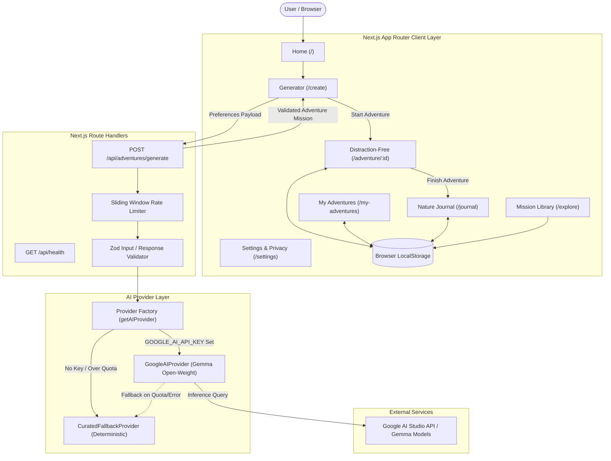
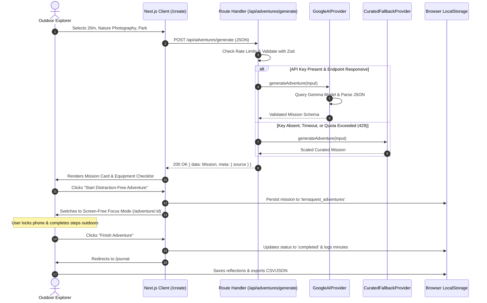

# TerraQuest AI — System Architecture

## 1. High-Level Architecture Overview

TerraQuest AI is architected as a **Local-First, Resilience-Optimized Web Application** built with Next.js (App Router), React 19, TypeScript, and Tailwind CSS. The system decouples AI planning from outdoor execution, ensuring that users can plan an activity in seconds, step outside into nature, and retain complete data ownership.



---

## 2. Layer-by-Layer Breakdown

### 2.1 Frontend Client Layer
- **Framework:** Next.js 16 with App Router, Turbopack, and React 19.
- **Visual Design:** Nature-inspired palette (`#173D2B`, `#102A20`, `#7BAE70`, `#DCE8D5`, `#F8F7F0`, `#E8BE71`), fluid typography, and dark/light mode toggle without flash.
- **State & Storage:** `localStorage` wrappers with safe SSR hydration checks for:
  - `terraquest_adventures`: Saved and completed missions.
  - `terraquest_journal`: Private reflection entries.
  - `terraquest_preferences`: User's last selected schedule and energy.
  - `terraquest_theme`: User's explicit theme preference.

### 2.2 Server-Side API Handlers
- **`POST /api/adventures/generate`**:
  - Request size enforcement (max 100KB).
  - In-memory sliding-window IP rate limiting (20 requests per 60 seconds).
  - Zod validation for input parameters (`durationMinutes`, `category`, `effort`, `group`, `budget`, `location`, `accessibilityNotes`).
  - Secure credential resolution (`process.env.GOOGLE_AI_API_KEY` never sent to client).
  - Sanitization of AI output (clearing potential markdown backticks, normalizing duration and step distributions).
- **`GET /api/health`**:
  - Exposes configured provider, model name, and engine readiness without leaking secrets.

### 2.3 AI Provider Architecture
The AI integration utilizes a **Provider Adapter Pattern**:
```typescript
export interface AIProvider {
  name: string;
  generateAdventure(input: AdventureRequestInput): Promise<GenerationResult>;
}
```
- **`GoogleAIProvider`:** Calls the official `@google/genai` SDK using the configured model (`AI_MODEL`, defaults to `gemma-2-9b-it`). Implements system instructions specifically tuned for grounded outdoor realism.
- **`CuratedFallbackProvider`:** Deterministic offline engine that scales durations, filters categories, and adapts safety guidelines without network connectivity or API key requirement.

---

## 3. Data Flow: Generation to Reflection



---

## 4. Resilience and Error Recovery

1. **Zero Cold-Start Failure:** If an invalid API key, network failure, or rate limit occurs, the app does not crash or show an empty screen. It immediately serves a rich, curated activity from the fallback engine and attaches a visible transparency badge.
2. **Safe Hydration:** All `localStorage` interactions check for `typeof window !== 'undefined'` and suppress hydration warnings on the root layout.
3. **Graceful Degradation:** The Nature Mission Library (`/explore`) does not depend on the AI API at all; it functions 100% offline.
